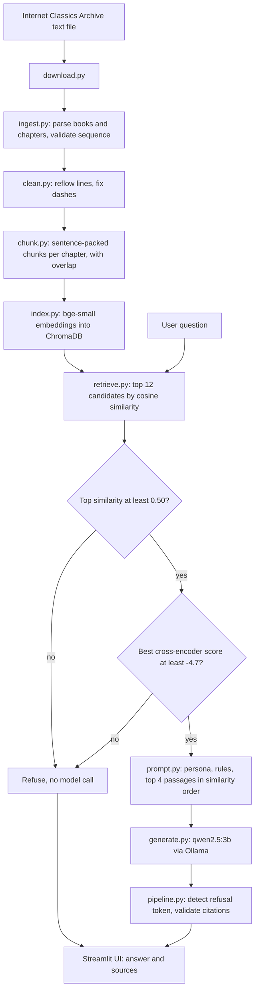

# Converse with Aristotle

A retrieval-augmented generation (RAG) chatbot that answers questions about Aristotle's *Nicomachean Ethics* using only passages retrieved from the text. Every answer cites the passages it relies on, the sources are shown next to the answer, and the system refuses when the text does not contain an answer instead of improvising. Everything runs locally on a CPU-only laptop with 8 GB of RAM, using open-source tools and no paid APIs.

> **Status: sprint complete, with documented limitations.** The pipeline, Streamlit interface and evaluation harness work end to end. Results below come from a frozen 26-question set, a separate 12-question held-out set written before the final configuration was chosen, and hand grading of every answered question by one person. Eight experiments are recorded, including the ones that failed. The full lab notebook is `eval/experiments.md`.

## Demo

<!-- TODO: add a GIF of one answered question with the Sources panel open, and one refusal. -->
`docs/demo.gif` (to be added)

## Why this project

A small local language model asked about Aristotle from memory sounds confident but gives no sources, drifts into modern self-help wording, and is not consistent from run to run. The baseline answers I recorded before adding retrieval are in `eval/baseline_no_rag.txt`. In one case the same model answered a question on one run and refused it on the next two, with identical settings.

This project grounds the model in the actual text, makes every claim traceable to a book and chapter, and measures how often that grounding holds, rather than judging it by eye. It also treats refusal as a first-class behaviour: a system that says "the text does not answer this" is more useful than one that always produces something.

## Architecture



The four passages sent to the model are the top four of the twelve candidates, in embedding-similarity order. The cross-encoder is used only to decide whether to refuse, not to rank (see Experiment 3).

### Components

| Module | Function | Purpose |
|---|---|---|
| `src/download.py` | `download_all()` | Fetches the raw text and saves the original bytes untouched |
| `src/ingest.py` | `load_documents()` | Parses the file into sections labelled by work, book and chapter, and fails loudly if the structure is off (chapters must count 1, 2, 3 within each book, all 10 books must be present) |
| `src/clean.py` | `clean_text()` | Reflows hard-wrapped lines into paragraphs and converts the archive's typed dashes, with a word-level check that nothing is lost |
| `src/chunk.py` | `chunk_documents()` | Structure-aware chunking: never crosses a chapter boundary, packs whole sentences up to a word limit, carries overlap, and folds tiny remainders back into the previous chunk |
| `src/index.py` | `embed_and_index()` | Embeds chunks with `BAAI/bge-small-en-v1.5` and stores vectors, text and citation metadata in ChromaDB |
| `src/retrieve.py` | `retrieve()`, `rerank_gate_score()` | Top-k cosine search with optional per-chapter cap and optional cross-encoder reranking; the cross-encoder score used for gating |
| `src/glossary.py` | `expand_query()` | Experimental: maps Greek terms to Ross's English words. Off by default (Experiments 5 and 6) |
| `src/prompt.py` | `build_prompt()` | Builds chat messages: Aristotle persona, grounding rules, numbered passages. `v1` is the shipped prompt, `v2` is the rejected stricter one |
| `src/generate.py` | `generate()`, `generate_stream()` | Calls the local model through Ollama with a fixed seed and capped answer length |
| `src/pipeline.py` | `answer()` | Two refusal gates, generation, refusal detection and citation validation |
| `app/streamlit_app.py` | | Chat interface that streams the answer and shows retrieved passages |
| `eval/evaluate.py` | `main()` | Retrieval-only and full-pipeline evaluation over any question file |
| `eval/` helpers | | Grading sheet builder, grade summariser, and comparison scripts for each experiment |

No orchestration framework (LangChain, LlamaIndex) is used. Each stage is short enough to write directly, and the aim was to understand the mechanics.

## Setup

Developed and run on Windows 11 with Python 3.14, 8 GB of RAM and no GPU. Commands below are PowerShell.

1. Install [Ollama](https://ollama.com) and pull the model:

   ```powershell
   ollama pull qwen2.5:3b
   ```

2. Create the environment and install dependencies:

   ```powershell
   git clone <your-repo-url>
   cd aristotle-rag
   python -m venv .venv
   .venv\Scripts\Activate.ps1
   pip install -r requirements.txt
   ```

   If PowerShell refuses to run the activation script, run `Set-ExecutionPolicy -Scope CurrentUser RemoteSigned` once.

3. Build the index (about a minute on CPU; the embedding model, about 130 MB, downloads on first use):

   ```powershell
   python -m src.download
   python -m src.clean
   python -m src.chunk
   python -m src.index
   ```

4. Start the app. The first question also downloads the cross-encoder (about 90 MB):

   ```powershell
   python -m streamlit run app/streamlit_app.py
   ```

   Use `python -m streamlit`, not plain `streamlit`, so the project's modules can be imported.

The source text is not stored in this repository (see Data and licensing). Step 3 downloads it and builds everything locally.

### Configuration (`config.py`)

| Setting | Shipped value | Meaning |
|---|---|---|
| `OLLAMA_MODEL` | `qwen2.5:3b` | Language model |
| `TOP_K` | 4 | Passages sent to the model |
| `MIN_TOP_SCORE` | 0.50 | Similarity gate |
| `RERANK_POOL` | 12 | Candidates scored by the cross-encoder gate (0 turns the gate off) |
| `RERANK_MIN_SCORE` | -4.7 | Cross-encoder gate threshold |
| `USE_GLOSSARY` | False | Greek-term query expansion (rejected, see Experiments 5 and 6) |
| `PROMPT_VERSION` | `v1` | `v2` was rejected (Experiment 7) |
| `SEED`, `TEMPERATURE` | 42, 0.2 | Reproducible generation |

## Sample interaction

**Q: What is justice?**

> Justice is a kind of mean, but not in the same way as the other virtues, related to an intermediate amount, while injustice relates to the extremes [1]. It is that in virtue of which the just man is said to be a doer, by choice, of that which is just ... [1].

Sources panel: `[1] Nicomachean Ethics V.5 | similarity 0.79 | cited`, followed by the passage, then the other retrieved passages tagged `retrieved`.

**Q: How does Kant's categorical imperative differ from Aristotle's view of duty?**

> I find nothing in the passages before me that answers this, and I will not guess.

Kant is absent from the book, but the question shares vocabulary with it (duty, virtue), so the top similarity was 0.66, higher than many legitimate questions. The similarity gate could not catch it. The cross-encoder gate did, in about a second, without calling the language model.

**A judgement call, kept on purpose. Q: How do we find happiness?** The answer said happiness is an activity "not dependent on external goods" and concluded that happiness is a form of contemplation, citing X.6. The X.6 passage does support the point about self-sufficiency, but the conclusion about contemplation comes from X.8, and X.8 also says a man will need external prosperity. In the evaluation this question was hand-graded as faithful, because the cited passage supports the claim it is attached to. Whether that counts as a failure depends on how strictly "faithful" is read, which is a limitation of single-person grading and one reason the evaluation reports faithfulness and answer quality as separate fields.

## Design decisions

**Chunking.** Chapters range from about 165 to 2,300 words, too long to embed or to fit several into a 4,096-token context window. Chunks target 180 words with 40 words of overlap and are built from whole sentences, splitting at semicolons where needed because Aristotle's sentences run long. A chunk never crosses a chapter boundary, so every chunk has an exact citation such as `Nicomachean Ethics IV.2`. A coverage test confirms that every sentence of every chapter appears intact in some chunk.

**Embeddings and index.** `bge-small-en-v1.5` has a 512-token limit, safely above the largest chunk, and runs on CPU. Embeddings are computed explicitly and normalised, and the Chroma collection uses cosine distance, so similarity is simply `1 - distance`. Queries get the model's retrieval instruction prefix and documents do not. ChromaDB was chosen over FAISS because it stores text and metadata alongside the vectors and persists to disk, which suits a corpus of a few hundred chunks.

**Three layers of refusal.** A similarity gate refuses clearly unrelated questions instantly. A cross-encoder gate (`cross-encoder/ms-marco-MiniLM-L-6-v2`, threshold -4.7) catches questions that share vocabulary with the text but are not answered by it. Finally, the system prompt tells the model to reply with a fixed token when the passages do not answer, and code replaces that token with a persona-voiced message. A small model cannot be trusted to refuse on its own, and a similarity threshold cannot separate on-topic from merely similar-sounding text, so the layers cover for each other. Each refusal records which layer produced it.

**Citations.** The model cites passage numbers like `[1]`, which a small model can copy reliably. Code translates them into real book and chapter citations from chunk metadata, flags numbers that do not exist, and flags answers with no citation.

**Model choice.** `qwen2.5:3b` was chosen over `llama3.2:3b` on three measurements: faster once loaded (13.7 s against 16.0 s for the same question), smaller in memory (2.2 GB against 2.6 GB), and more consistent across repeated runs. Generation uses a fixed seed, a low temperature and a capped answer length so runs are reproducible within a model state (see Caveats). The model name lives in `config.py`, so swapping in a hosted model later is a one-line change.

## Evaluation

Three question files, all hand-written, with the answering chapters found by reading the text and recorded before running the retriever:

| File | Size | Role |
|---|---|---|
| `eval/questions_v1.yaml` | 26 questions: 13 in-corpus, 9 out-of-corpus, 4 ambiguous (the text answers only part) | Frozen tuning set. Includes four phrasing pairs (neutral, second person, "Aristotle says") |
| `eval/extension_greek.yaml` | 7 questions containing Greek terms | Used only for the glossary experiment |
| `eval/heldout.yaml` | 12 questions: 4 in-corpus, 8 out-of-corpus | Written before the final configuration was chosen. Run six times in total with no setting changed except the reranker gate switch: four times with the final configuration, twice with the gate off. The first run is the one reported; the rest are repeats and the comparison |

```powershell
python -m eval.evaluate                                        # retrieval only, about a minute
python -m eval.evaluate --generate --questions eval/heldout.yaml   # full pipeline on any question file
python -m eval.make_grading_sheet                              # each answer beside the passages the model saw
python -m eval.summarize_grades eval/grades.yaml               # tallies the hand grades
```

Every run is saved to `eval/results/` with its settings (models, chunking, gates, prompt version, seed, number of chunks). Retrieved passage text used for grading goes to a git-ignored folder, not into the results files.

Each answered question was graded by hand against the exact passages the model saw, on two fields: `faithful` (does the answer say only what its cited passages support? A claim taken from an uncited passage counts as unfaithful) and `answers_question` (yes, partly or no).

### Results: frozen set, final configuration

Retrieval in embedding order, top 4 (a hit means a retrieved chunk came from a chapter listed as an answer):

| Category | n | hit@1 | hit@4 | hit@8 |
|---|---|---|---|---|
| In-corpus | 13 | 5/13 | 10/13 | 12/13 |
| Ambiguous | 4 | 0/4 | 2/4 | 4/4 |

Full pipeline (generation run `run_20261119_160901.json`, grades from the baseline run, 24 of 26 answers identical):

| Measure | Before the reranker gate | Final configuration |
|---|---|---|
| Out-of-corpus questions refused | 9/9 (5 similarity gate, 4 model) | 9/9 (5 similarity gate, 4 reranker gate) |
| In-corpus questions refused | 1/13 | 2/13 (q09 by the model, q21 by the reranker gate) |
| Questions answered | 15 | 13 |
| Answered, hand-graded faithful | 10/15 | 10/13 |
| Answered, both faithful and answering the question | 9/15 | 9/13 |
| In-corpus answers with no citation or an invalid citation number | 0/12 | 0/11 |

The reranker gate removed two answers that had been graded unfaithful (q21, q23) and no good ones, but its threshold was chosen on this set, so that gain is not independent evidence.

### Results: held-out set

| Measure | Final configuration | Reranker gate off |
|---|---|---|
| Out-of-corpus questions refused | 8/8 (5 reranker gate, 3 model) | 8/8 (all 8 by the model) |
| Refused by the similarity gate | 0 | 0 |
| In-corpus questions refused | 1/4 (h10, a Greek-term question) | 1/4 (h10, by the model) |
| Right chapter ranked first (retrieval) | 4/4 | 4/4 |
| Answered in-corpus, both faithful and answering | 1/3 | 1/3 |
| Time to refuse a question the reranker gate catches | about 1 s | 16 to 37 s |

Answer-or-refuse decisions and cited chapters were identical in all six held-out runs. The wording of the three answered questions took one of two forms, three runs each, and runs of the same form matched exactly (see Caveats). The frozen-set baseline rerun, made hours after the graded run, matched it exactly (26/26). `eval/results/INDEX.md` lists every saved run and what it was for.

### Experiments

Each decision rule was written before the run (`eval/experiments.md`).

| # | Change | Result | Decision |
|---|---|---|---|
| 1 | Cap of 2 chunks per chapter | No change at k=4 (10/13, 2/4) | Rejected |
| 2 | k=6 instead of 4 | Recall up (12/13, 3/4) and one false refusal recovered, but a poet question was answered from a passing mention (out-of-corpus refusals 9/9 to 8/9), answers cited up to five chapters, and time roughly doubled | Rejected |
| 3 | Cross-encoder as a ranker (pools 8, 12, 20) | Net 0, +1 and -1 hits, and an easy question demoted at pool 20 | Not used for ranking |
| 4 | Cross-encoder as a refusal gate (threshold -4.7, midpoint of the gap in scores) | All 9 out-of-corpus refused; two answers graded unfaithful became refusals; the other 24 answers unchanged | Adopted |
| 5 | Glossary: add Ross's English words for Greek terms to the query | Hit@4 on five Greek-term questions rose from 1/5 to 3/5, but every expanded question's gate score rose 8 to 10 points, letting two out-of-corpus questions through | Rejected |
| 6 | Four ways of building the gate query | None refused both out-of-corpus questions and answered at least 3 of 5 in-corpus ones | Glossary stays off |
| 7 | Stricter prompt (cite only passages that directly answer, no merging) | Refusals held, but three previously good answers got worse (q08, q24, q26) and one more question was refused | Rejected by its own rule |
| 8 | Held-out run with and without the reranker gate | The model alone refused all 8 out-of-corpus questions; the gate added speed and a second layer, not measured accuracy | Gate kept |

### What the results show

- **A similarity score cannot separate related from answerable.** On unseen questions, every out-of-corpus question scored 0.60 to 0.70, so the 0.50 similarity gate refused none of them. The cross-encoder gate separated the groups far better on the tuning set, and the held-out run confirms it refuses the right questions, though the model would have refused them anyway.
- **The model's own refusal was the last line of defence, and it held.** Without the reranker gate, the model refused every hard out-of-corpus question it was given (13 of 13 across the frozen, extension and held-out sets). The one exception was under a non-final configuration (k=6). This is a small sample with one prompt and one seed.
- **Ranking is the main retrieval weakness.** The right chapter is in the top 8 for 12 of 13 in-corpus questions but in the top 4 for 10. Giving the model more passages (k=6) increased recall but made it cite more broadly and answer a question it should have refused.
- **Most bad answers had the right chapter in view.** Of the six unfaithful or non-answering answers in the baseline, four had an expected chapter among the passages the model saw. Better retrieval alone would not have fixed them.
- **The automatic metric is a weak proxy for faithfulness.** On the held-out set, all three answers cited an expected chapter, yet only one was graded faithful and answering. Chapter-level scoring also cannot see a claim credited to the wrong chunk of the right chapter.
- **Vocabulary gap.** Ross translates the Greek *eudaimonia* as "happiness" and never prints the Greek, so questions that use the Greek word retrieve poorly. The final system refuses them (q21 and h10). Rephrasing with the English word works.
- **Phrasing effects are small.** Across four pairs, second-person phrasing lowered the top score by up to 0.06, while "What does Aristotle say about..." raised it for one pair. Retrieved chapters were as good or better in all four.

### Failure types observed

| Type | Example | What happened |
|---|---|---|
| Retrieval miss | "What is eudaimonia?" | The defining chapter (I.7) was not retrieved; the answer was built from I.12 and never defined the term. The final system refuses this question |
| Right chapter in view, a different one used | An ambiguous question touching death | The expected chapter was ranked second, but the answer cited I.10 |
| Contradiction of the cited passage | "How do we cultivate virtue?" | The answer carried over a comparison between virtue and cleverness in a way the cited passage contradicts |
| Claim attributed to the wrong passage | An ambiguous question on government | A point about equality was credited to a chapter that does not mention government |
| Wrong chunk within the right chapter | "What are the qualities of the proud man?" (held-out) | Traits of the vain man and the proud man were credited to the wrong passage numbers, all inside one chapter |
| Uncited passage used | "What is the difference between inquiry and deliberation?" (held-out) | The answer used content from a retrieved passage it did not cite |
| False refusal from a retrieval miss | "Is self-love a virtuous act?" | The answering chapter was ranked fifth and never reached the model |

### Caveats

- All grading was done by one person, and some grades were revised between passes. Faithfulness figures are indicative, not precise. A blind regrade of a subset would measure consistency.
- The sets are small, so one question moves a percentage by 8 to 10 points, and counts are reported alongside percentages. The held-out set has only four in-corpus questions, so it says little about hit rates and was built mainly to test refusal.
- The frozen-set numbers are tuning-set numbers. The held-out set was run six times in total (four with the final configuration, two with the reranker gate off), with no setting changed between runs other than that switch and no tuning after seeing results.
- Timings vary with machine load. The same answered questions took 10 to 32 seconds in one run and 24 to 45 seconds in another, so treat per-answer time as roughly 10 to 50 seconds on this hardware.
- Reproducibility was checked on one machine (Windows 11, CPU only, Ollama 0.40.16) with the library versions in `requirements.txt`. Retrieval is identical across runs apart from one near-tie rank swap on one out-of-corpus question across five runs. Generation is reproducible within a model state but not across states: over six held-out runs the answer-or-refuse decisions and cited chapters never changed, but the wording of the three answered questions took one of two forms, three runs each, and runs of the same form matched exactly, including runs hours apart and runs with the reranker gate on and off. The two forms line up with whether the model had been idle for more than 30 minutes before the run (a hypothesis from the run timestamps, not yet confirmed; one possible cause is Ollama reusing cached prompt processing). Hand grades therefore belong to the wording of the graded run, and the demo app, which usually runs on a warm model, may word answers differently from the graded ones.
- Reranker scores are logits specific to this model, so changing the cross-encoder means recalibrating the threshold.

## Known limitations

- Questions that use a Greek term (for example *eudaimonia* or *enkrateia*) are refused. The glossary that fixes retrieval for them also opens the refusal gate, so it is off.
- Answers are stitched from near-verbatim passages and can read as archaic to a modern reader. Paraphrase would help readability but is where a 3B model drifts from the text.
- There is no conversation memory. Each question is answered independently, so a follow-up like "and what about courage?" fails.
- Citation markers prove the model copied a number, not that the claim matches the passage. Some claims use content from passages the answer does not cite.
- The cross-encoder gate judges topical relevance, not whether the specific source asked about is in the book. A question naming another philosopher on a topic the text covers can pass it, leaving the model's refusal as the only defence.
- Verse quotations are reflowed into short paragraphs, and some chunks begin mid-sentence because splitting happens at semicolons.
- The corpus is one book in one translation. "Out of corpus" means outside this translation of this work, not outside Aristotle's thought (the real Aristotle wrote on poetry, for example).
- Answer wording is reproducible within a model state but can differ after the model reloads (see Caveats), so a faithfulness grade for one run is not guaranteed to transfer to another.
- A 3B model on CPU is slow, and answer quality is variable.

## Future work

- Merge adjacent chunks of the same chapter into one numbered passage, so citation granularity matches what is scored.
- A check that flags answers using content from uncited passages.
- A combined gate that uses both the original and glossary-expanded scores, evaluated on a fresh held-out set.
- A larger cross-encoder (for example `BAAI/bge-reranker-base`) if memory allows.
- Add Aristotle's *Politics* (needs its own parser).
- Conversation memory through query rewriting.
- Blind regrading to measure grading consistency.

## Data and licensing

The text is the English translation of the *Nicomachean Ethics* by W. D. Ross as published by [The Internet Classics Archive](http://classics.mit.edu/Aristotle/nicomachaen.html) (MIT). The archive's own statement reserves rights over its web presentation, so this repository does not include the downloaded text, the processed chunks or the index. `data/` is git-ignored, and `src/download.py` fetches the file for you. Check the translation's public-domain status for your own country before redistributing it.

Evaluation result files and the sample interactions above contain the model's answers, which often follow the retrieved passages closely and so include short excerpts of the translation. They do not contain the retrieved passages themselves. Grading notes are paraphrased. For a copy with no excerpts at all, delete `eval/results/` before redistributing.

## Repository structure

```
aristotle-rag/
  README.md
  requirements.txt
  config.py            # model names, paths, chunking, gates, prompt version
  src/                 # pipeline modules (see Components)
  app/streamlit_app.py
  eval/
    questions.yaml     # working copy of the tuning set
    questions_v1.yaml  # frozen copy used for the baseline
    extension_greek.yaml
    heldout.yaml
    evaluate.py
    make_grading_sheet.py
    summarize_grades.py
    grades*.yaml       # hand grades, one file per graded run
    experiments.md     # lab notebook with pre-registered decision rules
    baseline_no_rag.txt
    results/           # one JSON file per evaluation run, plus INDEX.md
  scratch/             # diagnostic and comparison scripts used while building
  data/                # git-ignored: raw text, processed JSON, Chroma index,
                       # grading sheets and the passages saved for grading
```
